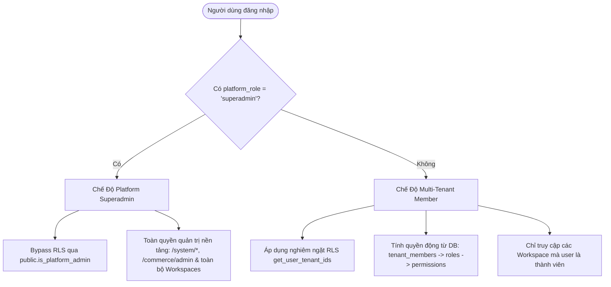
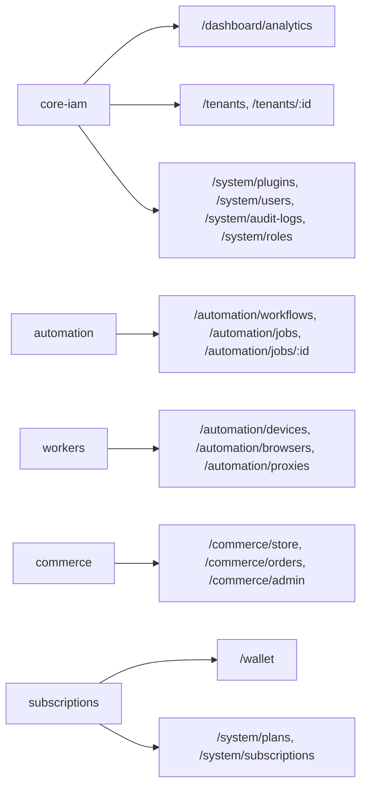

# Kiến Trúc Hệ Thống Admin (Admin Architecture)

> **Mã tài liệu:** `ARCH-ADMIN-OVERVIEW`  
> **Áp dụng cho:** `tuquet/admin` (`apps/web-admin`)  
> **Backend gắn kết (SSOT):** `tuquet/cloud/supabase`  
> **Trạng thái:** **ACTIVE & ACCEPTED**  
> **Tài liệu đặc tả từng route:** [`docs/routes/index.md`](../routes/index.md)  
> **Chuẩn thiết kế giao diện:** [`docs/architecture/styling-guide.md`](styling-guide.md)

---

## 1. Tổng Quan Hệ Thống (System Overview)

Web Admin là bảng điều khiển quản trị tập trung (Unified Management Console) của **Hệ sinh thái Tuquet**, đảm nhiệm 4 trụ cột cốt lõi:

1. **Multi-Tenant IAM:** Quản lý danh tính, phân quyền thành viên và tổ chức không gian làm việc (Workspaces / Tenants).
2. **Workers Fleet Control:** Điều phối và giám sát hạ tầng máy trạm phân tán (Desk, Headless Runners, Chromium automation profiles, Proxy pool).
3. **Automa Engine Telemetry:** Giám sát kịch bản quy trình tự động hóa (Workflows), tiến độ các đợt chạy (Campaign Runs) và nhật ký thực thi (Execution Logs).
4. **Digital Commerce & Multi-Channel Payment:** Cửa hàng sản phẩm số nội bộ (`/commerce/*`) và công khai (`/store`), Ví trả trước đơn vị `Xu` (`BIGINT`), cổng thanh toán đa kênh (VietQR, MoMo, Stripe, Crypto USDT) và tự động bàn giao tài nguyên (Auto-Fulfillment).

Hệ thống kết nối trực tiếp đến **Cloud** (`tuquet/cloud/supabase`), tương tác với 7 schema chuyên biệt qua chuẩn PostgREST và tuân thủ nghiêm ngặt bảo mật Row Level Security (RLS).

---

## 2. Các Nguyên Tắc Thiết Kế Cốt Lõi (Core Principles)

1. **KISS & YAGNI (Keep It Simple, Stupid & You Aren't Gonna Need It):**
   - Loại bỏ thanh Tabbar Chrome ảo trong SPA (`preferences.tabbar.enable = false`) để tiết kiệm không gian màn hình.
   - Header tối giản với các thành phần cốt lõi: Logo Tuquet, chuyển đổi Ngôn ngữ/Theme, Avatar & Menu người dùng.
   - Sidebar tinh gọn trong **6 nhóm chức năng chính**: `Dashboard`, `Workspaces`, `Automation`, `Commerce`, `Wallet`, `System`.
2. **Dữ Liệu Đo Đếm Thực Tế (100% Real Telemetry — Zero Mock Data):**
   - Tuyệt đối không dùng Mock Data hay số liệu giả lập. Toàn bộ số liệu trên console phản ánh chính xác trạng thái thực tế từ cơ sở dữ liệu và telemetry máy trạm.
   - Khi bảng dữ liệu rỗng, hiển thị Empty State chuẩn mực kèm biểu tượng Lucide và hướng dẫn kết nối.
3. **Chuẩn Hóa Bảng Dữ Liệu & Biểu Mẫu (`useVbenVxeGrid` & `VxeForm`):**
   - Toàn bộ các màn hình danh sách sử dụng `useVbenVxeGrid` (`VxeTable`) từ `src/adapter/vxe-table.ts`, tích hợp thanh lọc `formOptions`, đường kẻ semantic token tinh tế (`--vxe-ui-table-border-color: hsl(var(--border) / 40%)`), cuộn ngang tự nhiên (`overflow-x: auto`) và phân trang căn giữa trên thiết bị di động (xem).
   - Toàn bộ trang chi tiết và hộp thoại modal sử dụng `VxeForm`, `VxeFormItem`, `VxeFormGroup`.
   - Bảo toàn vị trí cuộn và triệt tiêu hiệu ứng nháy trang khi thay đổi URL query nội trang (`?tab=`, `?status=`).
4. **Quy Chuẩn Semantic Design Tokens, Iconography & Từ Điển 3 Tầng:**
   - Chia sẻ bộ Design Tokens HSL trong `internal/tailwind-config/src/theme.css` (`--background`, `--foreground`, `--primary`, `--border`, `--radius`).
   - Duy nhất sử dụng [Lucide Icons](https://lucide.dev/) (`@lucide/vue`), nghiêm cấm sử dụng Emoji làm biểu tượng hệ thống.
   - Hệ thống đa ngôn ngữ (`en-US` / `vi-VN`) phân tách 3 tầng từ điển: `common.json` (hành động phổ quát), `term.json` (thuật ngữ miền chuẩn), và `page.json` (nhãn đặc thù màn hình), tuân thủ nghiêm ngặt **Sentence case** tiếng Việt và nguyên tắc _Brevity_ (nói ít hiểu nhiều).

---

## 3. Kiến Trúc Đa Schema PostgREST (Multi-Schema Protocol)

Cloud phân tách dữ liệu thành **7 schema chuyên biệt** nhằm đảm bảo tính toàn vẹn và cô lập dữ liệu:

| Tên Schema | Phạm Vi Chức Năng | Bảng Dữ Liệu Tiêu Biểu | Header PostgREST Bắt Buộc |
| :-- | :-- | :-- | :-- |
| `public` | Quản lý danh tính, Workspace, RBAC, Plugins | `tenants`, `profiles`, `system_plugins`, `roles`, `permissions`, `audit_logs` | _(Mặc định — không cần header)_ |
| `workers` | Quản lý thiết bị máy trạm, Chromium, Proxies | `devices`, `browsers`, `proxies` | `Accept-Profile: workers` |
| `automation` | Kịch bản đồ họa, chiến dịch chạy, nhật ký bước | `workflows`, `campaign_runs`, `execution_logs` | `Accept-Profile: automation` |
| `billing` | Hợp đồng thuê bao SaaS, gói cước, Ví Xu & Thanh toán | `subscriptions`, `plans`, `usage_meters`, `wallets`, `wallet_transactions`, `payment_gateways`, `payment_intents` | `Accept-Profile: billing` |
| `commerce` | Cửa hàng sản phẩm số, kho serial, đơn hàng & giao hàng | `categories`, `products`, `product_variants`, `stock_items`, `orders`, `order_items`, `order_deliveries` | `Accept-Profile: commerce` |
| `media` | Tệp tin lưu trữ và tài nguyên đa phương tiện | `assets`, `buckets` | `Accept-Profile: media` |
| `events` | Hàng đợi sự kiện Transactional Outbox & Webhooks | `outbox`, `webhook_endpoints`, `webhook_deliveries` | `Accept-Profile: events` |

### Hợp Đồng Giao Tiếp API Client:

Toàn bộ các truy vấn HTTP tới Supabase sử dụng hàm dùng chung `supabaseRequest<T>()` tại `src/api/core/supabase-client.ts`:

```typescript
export type AdminSchema =
  'automation' | 'billing' | 'commerce' | 'events' | 'media' | 'public' | 'workers';

export interface SupabaseRequestOptions extends RequestInit {
  preferRepresentation?: boolean;
  schema?: AdminSchema;
  skipAuth?: boolean;
}
// GET / HEAD -> headers['Accept-Profile'] = schema
// POST / PUT / PATCH / DELETE -> headers['Content-Profile'] = schema
```

---

## 4. Mô Hình Phân Quyền & Hai Chế Độ Truy Cập (Security & Access Models)

Hệ thống vận hành theo 2 chế độ truy cập rõ rệt (kết hợp truy cập công khai `skipAuth` trên `/store`):



### 4.1. Chế Độ Multi-Tenant Member (User Thông Thường)

- **Cô lập RLS:** Người dùng chỉ có thể xem và thao tác trên những tenant mà họ là thành viên thông qua hàm `get_user_tenant_ids()`.
- **Động hóa quyền hạn từ Database:**
  - Tuyệt đối không suy quyền giao diện từ JWT claim (JWT hook bị giới hạn 25 permissions, trong khi Owner có đầy đủ quyền trên mọi module).
  - Quyền hạn được truy vấn trực tiếp từ cơ sở dữ liệu qua chuỗi quan hệ: `tenant_members` $\rightarrow$ `member_roles` $\rightarrow$ `roles` $\rightarrow$ `role_permissions`.
  - Kết quả được lưu bộ nhớ đệm (single-flight in-memory cache) cho mỗi phiên làm việc để tối ưu số lần gọi mạng.

### 4.2. Chế Độ Platform Superadmin (Quản Trị Nền Tảng)

- **Nhận diện danh tính:** Tài khoản sở hữu claim `raw_app_meta_data.platform_role = 'superadmin'` trong bảng `auth.users` (chỉ có thể gán bởi service role backend).
- **Cơ chế Bypass RLS:** Hàm bảo mật `public.is_platform_admin()` kiểm tra claim trên; các chính sách RLS cho phép tài khoản superadmin đọc toàn bộ dữ liệu trên mọi tenant (`public.tenants`, `public.profiles`, `public.audit_logs`, `billing.subscriptions`, `commerce.orders`).
- **Giao diện:** Router gán quyền `superadmin` vào bộ quyền hiệu lực, mở khóa các màn hình quản trị cấp cao tại `/system/users`, `/system/audit-logs`, `/system/subscriptions`, `/system/roles`, và `/commerce/admin`.

---

## 5. Bộ Lọc Định Tuyến Plugin Gate (`plugin-gate.ts`)

Mỗi tuyến đường nghiệp vụ trong hệ thống được gắn liền với một **Plugin ID** trong bảng `public.system_plugins`:



Khi ứng dụng khởi chạy, hàm thuần khiết `filterRoutesByPlugins(routes, installedPluginIds)` tự động ẩn toàn bộ các nhánh route có plugin chưa mang trạng thái `installed`. Trong nhóm hợp nhất `/automation` và `/commerce`, từng tuyến con được lọc độc lập theo plugin tương ứng.

---

## 6. Cơ Chế Giám Sát Tác Vụ & Polling (Telemetry & Polling)

- **Chiến lược Polling 3s:** Do bảng nhật ký `automation.execution_logs` phát sinh lưu lượng bản ghi lớn trong các chiến dịch tự động hóa hàng loạt, việc đưa bảng này vào WebSocket Realtime publication sẽ gây nghẽn băng thông.
- Giao diện chi tiết lần chạy (`/automation/jobs/:id`) cũng như hộp thoại chờ thanh toán đơn hàng (`/commerce/store`, `/wallet`, `/store`) thực hiện cơ chế polling định kỳ mỗi **3000ms** khi tác vụ đang ở trạng thái chờ xử lý.
- Khi trạng thái chuyển sang kết thúc (`completed`, `succeeded`, `failed`, `cancelled`), bộ đếm thời gian được hủy ngay lập tức để tiết kiệm tài nguyên mạng và pin thiết bị.

---

## 7. Cây Định Tuyến Tổng Thể (29 Routes Master Tree)

Hệ thống quản trị bao gồm **29 tuyến đường** chuẩn mực phân bổ trong **6 nhóm Sidebar chính** (21 tuyến nghiệp vụ) và cụm tuyến lõi `core.ts` (8 tuyến):

```text
/                                   BasicLayout (Chuyển hướng mặc định -> /dashboard/analytics)
├── /dashboard                      [core-iam]                lucide:layout-dashboard
│   └── /dashboard/analytics        Thống kê Telemetry thực tế từ Cloud & Loopback
├── /tenants                        [core-iam]                lucide:building-2
│   ├── /tenants                    Danh sách Workspace (VxeGrid)
│   └── /tenants/:id                Chi tiết Workspace (4 tabs: overview, members, usage, audit)
├── /automation                     [automation|workers]      lucide:workflow
│   ├── /automation/overview        [automation|workers]      Tổng quan engine & hạ tầng thực thi
│   ├── /automation/workflows       [automation]              Sơ đồ kịch bản Canvas Workflows
│   ├── /automation/jobs            [automation]              Lịch sử các đợt chạy chiến dịch
│   ├── /automation/jobs/:id        [automation]              Chi tiết lần chạy & Terminal Logs Viewer (Polling 3s)
│   ├── /automation/devices         [workers]                 Thiết bị & Nodes Desk / Cloud VPS
│   ├── /automation/browsers        [workers]                 Hồ sơ trình duyệt Chromium tự động hóa
│   └── /automation/proxies         [workers]                 Pool Proxy mạng phân tán
├── /commerce                       [commerce]                lucide:shopping-bag
│   ├── /commerce/store             [commerce]                Cửa hàng tài nguyên số & Thanh toán đa kênh
│   ├── /commerce/orders            [commerce]                Lịch sử đơn hàng & Hộp thoại nhận tài nguyên
│   └── /commerce/admin             [commerce]                Quản trị sản phẩm, nạp kho, duyệt lệnh & cổng thanh toán
├── /wallet                         [subscriptions]           lucide:wallet (alias /commerce/wallet)
│   └── /wallet                     Ví Xu trả trước & Sổ cái biến động số dư
└── /system                         [core-iam|subscriptions]  lucide:shield-check
    ├── /system/overview            [core-iam|subscriptions]  Tổng quan hệ thống & plugin
    ├── /system/plugins             [core-iam]                Danh mục Core Kernel & Extension Plugins
    ├── /system/plans               [subscriptions]           Bảng giá cước & Quotas SaaS
    ├── /system/users               [superadmin]              Người dùng toàn nền tảng
    ├── /system/audit-logs          [superadmin]              Nhật ký kiểm toán an ninh toàn cầu
    ├── /system/subscriptions       [superadmin]              Quản lý hợp đồng thuê bao các Workspace
    └── /system/roles               [superadmin]              Ma trận 4 System Roles & Permissions

Core, Auth & Public Storefront (core.ts — 8 routes):
/auth/login, /auth/register, /auth/forget-password, /auth/reset-password, /auth/callback, /auth/desktop, /profile, /store
```

---

## 8. Tiêu Chuẩn Giao Tiếp Mạng Cục Bộ (Private Network Access - PNA)

Khi Admin Console thực hiện thăm dò hoặc chuyển giao phiên đăng nhập SSO xuống daemon máy trạm Desk (`http://127.0.0.1:8765`):

1. **Lệnh Probe Analytics:** Gửi qua `fetch` với `mode: 'no-cors'` và `AbortController` timeout tối đa $1200\text{ms}$. Lỗi mạng được xử lý ngầm (non-blocking) để đảm bảo trang web vẫn render bình thường ngay cả khi daemon chưa khởi động.
2. **Desktop SSO Bridge (`/auth/desktop`):** Nhận `redirect_uri=http://127.0.0.1:8765/sso/callback`, xác thực phiên với Cloud và POST token về loopback port cục bộ.
