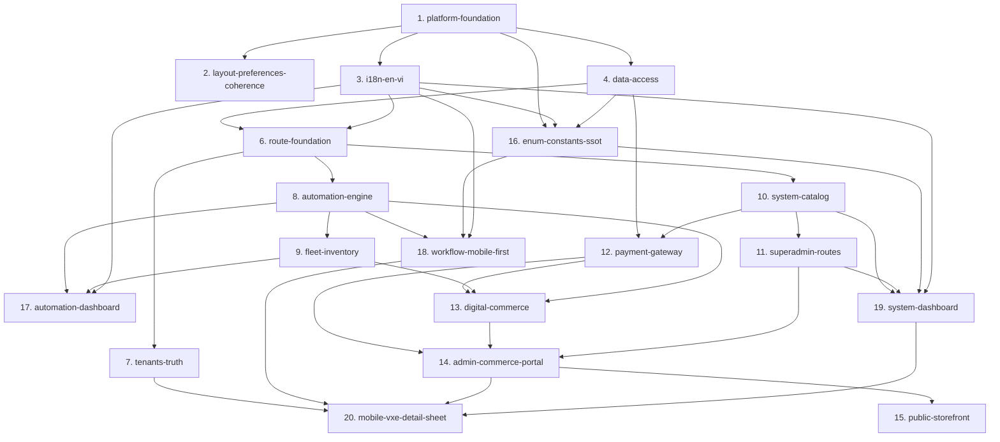

# Bản Đồ Năng Lực Hệ Thống (Admin Capability Map)

> **Trạng thái:** **ĐÃ HOÀN THÀNH (100% — 21/21 Canonical Modules)**  
> **Kiến trúc nguồn:** [`docs/architecture/overview.md`](../architecture/overview.md) | **Danh mục ADR:** 

---

## 1. Ma Trận 21 Module Năng Lực Chuẩn Hóa (Canonical Capability Matrix)

| STT | Module ID | Tệp Đặc Tả (`SPEC-*.md`) | Trách Nhiệm Cốt Lõi | Phụ Thuộc |
| :-: | :-- | :-- | :-- | :-- |
| 1 | `platform-foundation` | [`SPEC-core-platform-foundation.md`](SPEC-core-platform-foundation.md) | Kiến trúc monorepo (`pnpm` + `turbo`), hạ tầng build cục bộ `build:local`, vòng đời PWA auto-update, và cổng kiểm định chất lượng (`vue-tsc`, `oxlint`, `vitest`) | — |
| 2 | `layout-preferences-coherence` | [`SPEC-ui-layout-preferences.md`](SPEC-ui-layout-preferences.md) | Kiểm toán chống khóa giao diện (Anti-Lockout), bảo vệ điều hướng Sidebar, cô lập `initialPreferences` và đồng bộ 100% Preferences Drawer với Layout | `platform-foundation` |
| 3 | `i18n-en-vi` | [`SPEC-cross-i18n-en-vi.md`](SPEC-cross-i18n-en-vi.md) | Kiến trúc đa ngôn ngữ `en-US` / `vi-VN` đối xứng 100%, từ điển thuật ngữ `term.json`, tái sử dụng `$t('common.*')`, và quy chuẩn Sentence case tiếng Việt | `platform-foundation` |
| 4 | `data-access` | [`SPEC-core-data-access.md`](SPEC-core-data-access.md) | Tầng truy xuất `supabaseRequest({ schema, skipAuth })` đa schema (`public`, `workers`, `automation`, `billing`, `commerce`, `media`, `events`), nạp quyền hiệu lực từ DB và danh sách plugin `installed` | `platform-foundation` |
| 6 | `route-foundation` | [`SPEC-core-route-foundation.md`](SPEC-core-route-foundation.md) | Kiến trúc 27 routes (5 phân hệ Sidebar `/dashboard`, `/tenants`, `/automation`, `/commerce`, `/system` + 8 routes `core.ts`), bộ lọc `filterRoutesByPlugins()`, và bảo toàn cuộn nội trang | `data-access`, `i18n-en-vi` |
| 7 | `tenants-truth` | [`SPEC-tenants-management-truth.md`](SPEC-tenants-management-truth.md) | Quản trị `/tenants` (`useVbenVxeGrid`) và `/tenants/:id` (4 chế độ `overview / members / usage / audit` với `useVbenVxeGrid`), mời thành viên (`tenant_invitations`) và gán vai trò (`member_roles`) | `route-foundation` |
| 8 | `automation-jobs` | [`SPEC-automation-jobs.md`](SPEC-automation-jobs.md) | Quản trị kịch bản `/automation/workflows` (`automation.workflows`), lịch sử chạy `/automation/jobs` (`automation.jobs`), và chi tiết nhật ký `/automation/jobs/:id` (`automation.execution_logs` polling 3s) qua client hợp nhất `src/api/core/automation.ts` | `route-foundation` |
| 9 | `fleet-inventory` | [`SPEC-automation-browsers.md`](SPEC-automation-browsers.md) [`SPEC-automation-devices.md`](SPEC-automation-devices.md) [`SPEC-automation-proxies.md`](SPEC-automation-proxies.md) | Quản trị hạ tầng thực thi dưới `/automation`: thiết bị `/automation/devices` (`workers.devices`), hồ sơ trình duyệt `/automation/browsers` (`workers.browsers`), và bể proxy `/automation/proxies` (`workers.proxies`) dùng `useVbenVxeGrid` | `route-foundation`, `automation-jobs` |
| 10 | `system-catalog` | [`SPEC-system-catalog.md`](SPEC-system-catalog.md) | Quản trị kho plugin hệ thống `/system/plugins` (`public.system_plugins` — phân tách 6 Core Kernel Plugins & Extension Plugins) và bảng giá gói cước `/system/plans` (`billing.plans`) bằng `useVbenVxeGrid` | `route-foundation` |
| 11 | `superadmin-routes` | [`SPEC-system-superadmin-routes.md`](SPEC-system-superadmin-routes.md) | Bộ 4 trang đặc quyền giám sát xuyên tenant cho Platform Superadmin: `/system/users`, `/system/roles`, `/system/subscriptions`, và `/system/audit-logs` chuẩn hóa 100% trên `useVbenVxeGrid` | `route-foundation`, `system-catalog` |
| 12 | `payment-gateway` | [`SPEC-commerce-payment-gateway.md`](SPEC-commerce-payment-gateway.md) | Cổng thanh toán đa kênh theo chuẩn Provider Adapter (`bank_transfer` VietQR, `e_wallet` MoMo, `card_intl` Stripe, `crypto` USDT, `internal_wallet` trừ Xu tức thì), Ví Xu Tenant (`billing.wallets` `BIGINT`), sổ cái `billing.wallet_transactions`, `billing.payment_intents` (`manual_review`) và Edge Function `payment-webhook` | `data-access`, `system-catalog` |
| 13 | `digital-commerce` | [`SPEC-commerce-digital-store.md`](SPEC-commerce-digital-store.md) | Phân hệ sản phẩm số (`schema: commerce`): 4 loại sản phẩm (`serial_stock`, `resource`, `digital_file`, `wallet_credit`), kho hàng chống bán trùng (`FOR UPDATE SKIP LOCKED`), máy trạng thái đơn hàng (`commerce.orders`) và giao hàng tự động xuyên schema (Auto-Fulfillment) | `payment-gateway`, `fleet-inventory`, `automation-engine` |
| 14 | `admin-commerce-portal` | [`SPEC-commerce-admin-portal.md`](SPEC-commerce-admin-portal.md) | Cổng thương mại điện tử nội bộ dưới `/commerce`: Cửa hàng `/commerce/store`, Lịch sử đơn & nhận hàng `/commerce/orders`, Ví Xu `/wallet`, và Trung tâm quản trị `/commerce/admin` (sản phẩm, nạp kho hàng loạt, duyệt `manual_review`, cấu hình cổng thanh toán) | `payment-gateway`, `digital-commerce`, `superadmin-routes` |
| 15 | `public-storefront` | [`SPEC-commerce-public-storefront.md`](SPEC-commerce-public-storefront.md) | Cửa hàng sản phẩm số công khai `/store` (`ignoreAccess: true`, `skipAuth: true`) cho khách vãng lai (Guest Checkout): thanh toán đa kênh (Realtime Polling 3s) và nhận bàn giao tức thì qua `claim_token` (`CLM_...`) | `payment-gateway`, `digital-commerce`, `admin-commerce-portal` |
| 16 | `enum-constants-ssot` | [`SPEC-core-enum-constants-ssot.md`](SPEC-core-enum-constants-ssot.md) | Hệ thống Enum & Hằng số Đơn Nguồn Sự Thật (`as const` + Derived Union Types) tại `@tuquet/constants` và `#/constants`, đồng bộ tầng API (`src/api/core/*`), siêu dữ liệu huy hiệu (`StatusTone`) và bộ lọc đa ngôn ngữ (`buildEnumFilterOptions`) | `platform-foundation`, `i18n-en-vi`, `data-access` |
| 17 | `automation-dashboard` | [`SPEC-automation-dashboard.md`](SPEC-automation-dashboard.md) | Trang tổng quan `/automation/overview` tập trung toàn bộ KPI Kịch bản, Phiên chạy, Thiết bị, Trình duyệt & Proxy; lược bỏ khối thống kê rườm rà và tối ưu bộ lọc 2 cột trên Mobile cho 5 màn hình danh sách `/automation/*` | `automation-engine`, `fleet-inventory`, `i18n-en-vi` |
| 18 | `workflow-mobile-first` | [`SPEC-automation-workflow-mobile-first.md`](SPEC-automation-workflow-mobile-first.md) | Giao diện Mobile-First cho `/automation/workflows`, `/automation/jobs`, `/automation/jobs/:id`: thu gọn cột `VxeGrid` theo `isMobile` (không cuộn ngang trên `375px`), thanh lọc gọn nhẹ và hộp thoại xem chi tiết quy trình `WorkflowDetailModal` chuẩn baseline | `automation-engine`, `enum-constants-ssot`, `i18n-en-vi` |
| 19 | `system-dashboard` | [`SPEC-system-dashboard.md`](SPEC-system-dashboard.md) | Trang tổng quan `/system/overview` tập trung KPI của 6 phân hệ quản trị hệ thống (`plugins`, `plans`, `users`, `roles`, `subscriptions`, `audit-logs`), kèm tinh gọn bảng `VxeGrid` Mobile-First cho toàn bộ nhánh `/system/*` | `system-catalog`, `superadmin-routes`, `enum-constants-ssot`, `i18n-en-vi` |
| 20 | `mobile-vxe-detail-sheet` | [`SPEC-ui-mobile-vxe-detail-sheet.md`](SPEC-ui-mobile-vxe-detail-sheet.md) | Chuẩn hóa Sheet chi tiết & sửa nhanh bằng `VxeForm` (`VxeRowDetailSheet`) kèm đầy đủ các trường và nút hành động khi chạm/click vào dòng trên toàn bộ 19 bảng `useVbenVxeGrid` (15 trang) | `tenants-truth`, `workflow-mobile-first`, `admin-commerce-portal`, `system-dashboard` |
| 21 | `tauri-desktop` | [`SPEC-cross-tauri-desktop.md`](SPEC-cross-tauri-desktop.md) | Ứng dụng Native Desktop hoàn chỉnh trên nền tảng Tauri v2 (Frameless Titlebar, System Tray, SSO Deep Linking `tuquet://`, Window-state, Single-instance) | `platform-foundation`, `route-foundation` |

---

## 2. Thứ Tự Triển Khai & Phụ Thuộc Kiến Trúc (Canonical Build Order)

---

## 3. Phụ Thuộc Liên Kho Lưu Trữ (`tuquet/cloud`)

- **`cloud:platform-superadmin`:** Hàm `public.is_platform_admin()` và các chính sách RLS `SELECT / UPDATE` xuyên tenant cho Platform Superadmin.
- **`cloud:payment-gateway`:** Mở rộng `schema: billing` (`cloud/supabase/plugins/subscriptions/install.sql`) + Edge Function `cloud/supabase/functions/payment-webhook/`.
- **`cloud:digital-commerce`:** Plugin thương mại số `schema: commerce` (`cloud/supabase/plugins/commerce/install.sql`).
