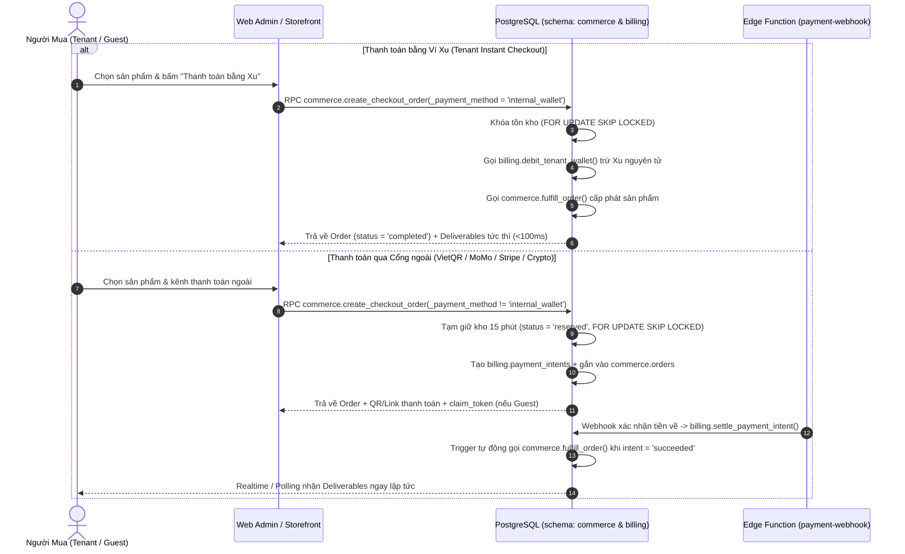

# Spec: Kho Sản Phẩm Số, Đơn Hàng & Tự Động Giao Hàng (`digital-commerce`)

> **Mã đặc tả:** `SPEC-digital-commerce`  
> **Module id:** `digital-commerce` (xem [`CAPABILITY-map-web-admin.md`](CAPABILITY-map-web-admin.md))  
> **Kiến trúc nguồn:** [`docs/architecture/overview.md`](../architecture/overview.md), [`SPEC-commerce-payment-gateway.md`](SPEC-commerce-payment-gateway.md)  
> **Phạm vi tác động:** `cloud/` (`schema: commerce` trong `supabase/plugins/commerce/`) + `admin/` (`apps/web-admin/src/api/core/commerce.ts`)  
> **Trạng thái:** **ĐÃ HOÀN THÀNH (IMPLEMENTED)**

---

## 1. Objective (Mục Tiêu Nghiệp Vụ & Kỹ Thuật)

Xây dựng phân hệ thương mại sản phẩm số đa năng (`schema: commerce`) cho phép **Central Platform Store** bán và bàn giao tự động 4 nhóm sản phẩm số cho cả **Tenant đã đăng nhập** (thanh toán bằng Ví Xu hoặc cổng thanh toán ngoài) và **Khách vãng lai (Guest Checkout)**:

1. **Tài khoản / License Key / Serial Text (`serial_stock`):**
   - Quản trị kho hàng dạng dòng văn bản (`uid|pass|2fa|recovery_mail`, mã kích hoạt phần mềm, voucher).
   - **Chống bán trùng tuyệt đối (Zero Double-Selling):** Sử dụng khóa dòng `FOR UPDATE SKIP LOCKED` để tạm giữ (`reserved`) khi tạo đơn và xuất kho (`sold`) nguyên tử ngay khi thanh toán thành công.
2. **Tài nguyên Hệ sinh thái (`resource`):**
   - Tự động cấp phát tài nguyên thẳng vào Workspace (`buyer_tenant_id`) của người mua ngay khi đơn hàng hoàn tất:
     - `proxy_pool`: Xuất proxy từ kho và nạp thẳng vào bảng `workers.proxies` của Tenant.
     - `automa_workflow`: Nhân bản (clone) kịch bản tự động hóa mẫu vào bảng `automation.workflows` của Tenant.
     - `plan_upgrade`: Nâng cấp hoặc gia hạn gói cước trong `billing.subscriptions` của Tenant.
3. **Tệp tin số tải xuống (`digital_file`):**
   - Liên kết với `media.assets` (tệp cài đặt, bộ dữ liệu, tài liệu ZIP/PDF), cấp quyền tải xuống có giới hạn số lượt (`max_downloads`) và thời hạn (`expires_at`).
4. **Gói nạp Xu trả trước (`wallet_credit`):**
   - Các gói mệnh giá nạp Xu (kèm Xu thưởng `bonus_credits`) giúp Tenant nạp số dư vào `billing.wallets` thông qua các cổng thanh toán ngoài (`bank_transfer`, `e_wallet`, `card_intl`, `crypto`).

---

## 2. Tech Stack

- **Database & Fulfillment Engine:** PostgreSQL 15+ (Supabase), cô lập trong `schema: commerce` (`cloud/supabase/plugins/commerce/install.sql`).
- **Concurrency & Isolation:** Row-level locking `FOR UPDATE SKIP LOCKED` chống xuất trùng phôi hàng dưới tải đồng thời cao; `SECURITY DEFINER` RPCs ghim `SET search_path = ''`.
- **Cross-Schema Orchestration:** Tích hợp nguyên tử giữa `commerce` ↔ `billing` (Ví Xu & Payment Intents) ↔ `workers` (Proxy Pool) ↔ `automation` (Workflows) ↔ `media` (Digital Assets).
- **Admin Web Data Client:** TypeScript (`apps/web-admin/src/api/core/commerce.ts`) qua `supabaseRequest({ schema: 'commerce' })`.

---

## 3. Commands (Lệnh Thực Thi & Kiểm Định)

```bash
# 1. Chạy unit tests cho lớp API commerce trong Web Admin
pnpm --filter @tuquet/admin-web run test:unit -- src/api/core/__tests__/commerce.test.ts

# 2. Kiểm tra kiểu tĩnh TypeScript
pnpm --filter @tuquet/admin-web run typecheck

# 3. Kiểm tra quy tắc linter oxlint
pnpm run lint
```

---

## 4. Project Structure (Cấu Trúc Tệp Nguồn)

```text
cloud/
├── supabase/
│   └── plugins/
│       └── commerce/
│           ├── plugin.json             # Manifest: quản lý 7 bảng trong schema commerce
│           ├── install.sql             # DDL/DML: bảng, RLS, RPCs giao hàng tự động & trigger liên kết billing
│           ├── uninstall.sql           # Gỡ bỏ sạch schema commerce
│           └── index.md               # Tài liệu kiến trúc kho & luồng Auto-Fulfillment
└── tests/
    └── db/
        └── 08_verify_commerce_plugin.sql # Bộ kiểm thử SQL chống bán trùng & cấp phát tài nguyên
admin/apps/web-admin/src/
└── api/core/
    ├── commerce.ts                     # Typed API client cho categories, products, variants, orders, deliveries
    └── __tests__/
        └── commerce.test.ts            # Unit tests kiểm chứng API commerce & lưu trữ đơn hàng Guest
```

---

## 5. Code Style & Kiến Trúc Chi Tiết

### 5.1. Sơ Đồ Luồng Đặt Hàng & Tự Động Giao Hàng (Order & Auto-Fulfillment Flow)



### 5.2. Mô Hình Dữ Liệu (`schema: commerce`)

- **Kiểu liệt kê (`ENUM`):**
  - `commerce.product_type`: `'serial_stock'`, `'resource'`, `'digital_file'`, `'wallet_credit'`
  - `commerce.stock_status`: `'available'`, `'reserved'`, `'sold'`, `'defective'`
  - `commerce.order_status`: `'pending_payment'`, `'paid'`, `'fulfilling'`, `'completed'`, `'manual_review'`, `'failed'`, `'cancelled'`, `'refunded'`
- **7 Bảng dữ liệu cốt lõi:**
  1. `commerce.categories`: Danh mục sản phẩm (`slug`, `name`, `icon`, `sort_order`, `is_active`).
  2. `commerce.products`: Sản phẩm số (`category_id`, `slug`, `name`, `product_type`, `visibility` gồm `'public' | 'tenant_only' | 'hidden'`, `fulfillment_config`).
  3. `commerce.product_variants`: Biến thể / SKU (`product_id`, `sku`, `name`, `price_credits` kiểu `BIGINT`, `stock_mode` gồm `'unlimited' | 'serialized' | 'finite_counter'`, `available_stock`, `sold_count`, `fulfillment_payload`).
  4. `commerce.stock_items`: Kho phôi hàng đơn chiếc (`variant_id`, `batch_code`, `secret_payload`, `public_hint`, `status`, `order_item_id`, `reserved_until`, `sold_at`, ràng buộc duy nhất `UNIQUE (variant_id, secret_payload)`).
  5. `commerce.orders`: Đơn hàng (`order_code` dạng `ORD-<YYMMDD>-<6HEX>`, `buyer_tenant_id`, `buyer_email`, `guest_claim_token_hash`, `payment_method`, `payment_intent_id`, `total_credits`, `status`).
  6. `commerce.order_items`: Chi tiết dòng đơn hàng (`order_id`, `product_id`, `variant_id`, `quantity`, `unit_price_credits`, `total_price_credits`, `fulfilled_quantity`).
  7. `commerce.order_deliveries`: Dữ liệu bàn giao cho người mua (`order_id`, `order_item_id`, `delivery_type`, `stock_item_id`, `delivered_payload`, `download_count`, `max_downloads`, `expires_at`).

### 5.3. Các Hàm RPC Nguyên Tử & Trigger Liên Kết (`schema: commerce`)

1. **`commerce.import_stock_batch(_variant_id UUID, _lines TEXT[], _batch_code VARCHAR)`:** Dành riêng cho `public.is_platform_admin()`, lọc bỏ dòng trống, chèn vào `commerce.stock_items` với `ON CONFLICT (variant_id, secret_payload) DO NOTHING` và đồng bộ `available_stock`.
2. **`commerce.release_expired_reservations(_variant_id UUID DEFAULT NULL)`:** Giải phóng các dòng `reserved` đã quá hạn (`reserved_until < now()`) về lại `'available'` và hủy các đơn `pending_payment` quá hạn.
3. **`commerce.create_checkout_order(...)`:** Kiểm tra quyền mua (Tenant hoặc Guest Checkout với `visibility = 'public'`), khóa tồn kho bằng `FOR UPDATE SKIP LOCKED`, trừ Ví Xu tức thì (nếu `internal_wallet`) hoặc khởi tạo `billing.payment_intents` kèm `claim_token` bảo mật (nếu Guest).
4. **`commerce.fulfill_order(_order_id UUID)`:** Thực thi bàn giao idempotent cho từng loại sản phẩm (`serial_stock`, `resource`, `digital_file`, `wallet_credit`) và cập nhật `orders.status = 'completed'`.
5. **Trigger `trg_commerce_on_payment_intent_settled`:** Lắng nghe bảng `billing.payment_intents`; tự động gọi `commerce.fulfill_order()` ngay khi lệnh thanh toán chuyển sang `'succeeded'` hoặc đánh dấu đơn hàng `'manual_review'` khi lệnh thanh toán bị giữ lại.
6. **`commerce.get_guest_order_deliveries(_order_code VARCHAR, _claim_token VARCHAR)`:** Cho phép khách vãng lai (`anon` / `authenticated`) tra cứu trạng thái đơn và nhận tài nguyên bàn giao thông qua mã băm SHA-256 của `_claim_token`.

---

## 6. Testing Strategy

1. **Kiểm thử SQL & Chống bán trùng (`08_verify_commerce_plugin.sql`):**
   - Xác minh toàn bộ 7 bảng trong `schema: commerce` bật RLS 100% và cô lập tuyệt đối bảng `commerce.stock_items` (chỉ Platform Admin được phép truy cập trực tiếp).
   - Xác minh luồng mua `serial_stock`, `resource` (`automa_workflow`, `proxy_pool`, `plan_upgrade`), `digital_file`, và `wallet_credit` hoạt động chính xác, không xuất trùng phôi hàng.
2. **Kiểm thử Typed Client API (`apps/web-admin/src/api/core/__tests__/commerce.test.ts`):**
   - Kiểm thử các hàm `getCommerceCategoriesApi`, `getCommerceProductsApi`, `getCommerceOrdersApi`, `getOrderDeliveriesApi`, `createCheckoutOrderApi`, `getGuestOrderDeliveriesApi`, `importStockBatchAdminApi`, `fulfillOrderAdminApi`, cùng các hàm lọc `filterCommerceProducts` và `filterCommerceOrders`.

---

## 7. Boundaries

- **Always do (Luôn thực hiện):**
  - Bật `ENABLE ROW LEVEL SECURITY` trên toàn bộ 7 bảng trong `schema: commerce`.
  - Cô lập tuyệt đối `commerce.stock_items`: người mua chỉ nhận dữ liệu đã xuất kho thông qua `commerce.order_deliveries` khi đơn hàng đạt trạng thái `'completed'`.
  - Sử dụng khóa dòng `FOR UPDATE SKIP LOCKED` khi giữ hàng hoặc xuất kho.
- **Ask first (Hỏi trước khi thực hiện):**
  - Bổ sung loại sản phẩm mới ngoài 4 loại chuẩn (`serial_stock`, `resource`, `digital_file`, `wallet_credit`).
- **Never do (Tuyệt đối cấm):**
  - Không bao giờ trả về cột `secret_payload` của `commerce.stock_items` khi đơn hàng chưa hoàn tất thanh toán (`status != 'completed'`).
  - Không bao giờ trừ tồn kho bằng câu lệnh `SELECT` rồi `UPDATE` tách rời ngoài khóa giao dịch.

---

## 8. Success Criteria

- [x] Plugin `cloud/supabase/plugins/commerce/` cài đặt sạch 7 bảng, các hàm RPC nguyên tử và trigger liên kết `billing.payment_intents`.
- [x] Chống bán trùng 100% (`FOR UPDATE SKIP LOCKED` + `UNIQUE (variant_id, secret_payload)`).
- [x] Tự động cấp phát tài nguyên `resource` trực tiếp vào `automation.workflows`, `workers.proxies`, và `billing.subscriptions` của Tenant mua hàng.
- [x] Lớp API `apps/web-admin/src/api/core/commerce.ts` và bộ kiểm thử `commerce.test.ts` vượt qua 100% bài test với `0` lỗi TypeScript/oxlint.

---

## 9. Resolved Decisions

1. **Tự động cấp phát xuyên Schema (Cross-Schema Auto-Fulfillment):** Khi người mua đặt gói `resource`, hàm `commerce.fulfill_order` thực thi cấp phát trực tiếp trong cùng giao dịch PostgreSQL vào `workers.proxies`, `automation.workflows`, hoặc `billing.subscriptions` mà không cần worker trung gian bên ngoài.
2. **Cơ chế Giữ hàng Tạm thời (`reserved_until` 15 phút):** Đối với các kênh thanh toán ngoại vi (VietQR, MoMo, Stripe, USDT), phôi hàng được giữ chỗ trong 15 phút và tự động giải phóng về `'available'` thông qua `commerce.release_expired_reservations` nếu người mua không hoàn tất thanh toán.
