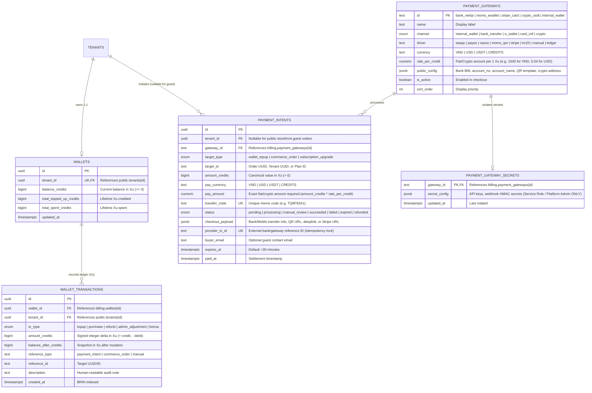

# Spec: Cổng Thanh Toán Đa Kênh & Ví Xu Tenant (`payment-gateway`)

> **Mã đặc tả:** `SPEC-payment-gateway`  
> **Module id:** `payment-gateway` (xem [`CAPABILITY-map-web-admin.md`](CAPABILITY-map-web-admin.md))  
> **Kiến trúc nguồn:** [`docs/architecture/overview.md`](../architecture/overview.md)  
> **Phạm vi tác động:** `cloud/` (`schema: billing` trong `supabase/plugins/subscriptions/` & `supabase/functions/payment-webhook/`) + `admin/` (`apps/web-admin/src/api/core/billing.ts`)  
> **Trạng thái:** **ĐÃ HOÀN THÀNH (IMPLEMENTED)**

---

## 1. Objective (Mục Tiêu Nghiệp Vụ & Kỹ Thuật)

Xây dựng hệ thống **Cổng Thanh Toán Đa Kênh Mở Rộng (Extensible Multi-Platform Payment Gateway) & Ví Trả Trước (`Xu`)** trên nền tảng `schema: billing` (`subscriptions` plugin) kết hợp Edge Function đối soát Webhook tự động (`payment-webhook`) và lớp truy xuất dữ liệu tĩnh `src/api/core/billing.ts`.

### Tác Nhân & Luồng Nghiệp Vụ (User Stories)

1. **Người mua (Tenant hoặc Khách vãng lai trên Public Storefront):** Có thể thanh toán đơn hàng hoặc nạp số dư qua 5 kênh: **Chuyển khoản Ngân hàng Nội địa** (Napas247 / VietQR tự động điền mã nội dung), **Ví điện tử** (MoMo / ZaloPay), **Thẻ Quốc tế** (Stripe), **Tiền mã hóa** (USDT TRC20/BEP20 / Binance Pay), hoặc **Ví Xu trả trước của Tenant (`internal_wallet`)** (khấu trừ 1 chạm tức thì).
2. **Người mua:** Ngay khi giao dịch chuyển khoản ngân hàng/MoMo/Crypto chứa mã nội dung định danh (ví dụ `TQ8F92A1`) được Webhook xác nhận, màn hình thanh toán tự động cập nhật trạng thái và sản phẩm số hoặc số dư Xu được bàn giao trong vài giây.
3. **Quản trị viên Nền tảng (Platform Superadmin):** Có thể thêm, bật/tắt, cấu hình tỷ giá quy đổi (`rate_per_credit`) cho từng cổng thanh toán và duyệt thủ công (`_force_approve = TRUE`) các lệnh thanh toán bị giữ lại ở trạng thái `manual_review` (do chuyển khoản trễ hạn hoặc thiếu tiền) ngay trên giao diện Web Admin mà không cần triển khai lại mã nguồn backend.

---

## 2. Tech Stack

- **Database & Core Ledger:** PostgreSQL 15+ (Supabase), cô lập trong `schema: billing` (`cloud/supabase/plugins/subscriptions/install.sql`).
- **Authorization & RLS:** Row-Level Security $O(1)$ không đệ quy (`public.is_tenant_member`, `public.has_tenant_permission`, `public.is_platform_admin`) và các hàm RPC `SECURITY DEFINER` ghim `SET search_path = ''`.
- **Webhook Ingestion Runtime:** Supabase Edge Functions (Deno / TypeScript) tại `cloud/supabase/functions/payment-webhook/index.ts` sử dụng chuẩn Web Crypto API (`crypto.subtle`) để xác thực chữ ký HMAC-SHA256.
- **Event Distribution:** PostgreSQL Transactional Outbox (`events.outbox` qua `events.emit_event`).
- **Admin Web Data Client:** TypeScript (`apps/web-admin/src/api/core/billing.ts`) qua `supabaseRequest({ schema: 'billing' })`.

---

## 3. Commands (Lệnh Thực Thi & Kiểm Định)

```bash
# 1. Chạy unit tests cho lớp API billing trong Web Admin
pnpm --filter @tuquet/admin-web run test:unit -- src/api/core/__tests__/billing.test.ts

# 2. Kiểm tra kiểu tĩnh TypeScript
pnpm --filter @tuquet/admin-web run typecheck

# 3. Kiểm tra quy tắc linter oxlint
pnpm run lint
```

---

## 4. Project Structure (Cấu Trúc Tệp Nguồn)

```text
cloud/
├── supabase/
│   ├── plugins/
│   │   └── subscriptions/
│   │       ├── plugin.json             # Manifest: quản lý plans, subscriptions, wallets, gateways, intents
│   │       ├── install.sql             # DDL/DML: schema billing, RLS, RPCs, dữ liệu cổng mặc định
│   │       ├── uninstall.sql           # Gỡ bỏ sạch schema billing
│   │       └── index.md               # Tài liệu ERD và Payment Adapter
│   └── functions/
│       └── payment-webhook/
│           ├── index.ts                # Bộ định tuyến webhook (/payment-webhook?provider=<driver>)
│           └── adapters/
│               ├── types.ts            # Giao diện chuẩn NormalizedWebhookSettlement
│               ├── bank-webhook.ts     # Bộ phân tích mã TQxxxxxx & xác thực HMAC cho SePay, PayOS, Casso, Web2M
│               ├── ewallet-webhook.ts  # Bộ phân tích MoMo IPN & ZaloPay callback
│               ├── stripe-webhook.ts   # Xác thực chữ ký Stripe & checkout.session.completed
│               └── crypto-webhook.ts   # Xác thực webhook USDT TRC20/BEP20 & Binance Pay
admin/apps/web-admin/src/
└── api/core/
    ├── billing.ts                      # Typed API client cho wallets, transactions, gateways, payment_intents
    └── __tests__/
        └── billing.test.ts             # Unit tests kiểm chứng các hàm truy vấn và đối soát thanh toán
```

---

## 5. Code Style & Kiến Trúc Chi Tiết

### 5.1. Mô Hình Thực Thể Sổ Cái & Thanh Toán (`schema: billing`)

Mọi số dư nội bộ, bảng giá sản phẩm và bút toán sổ cái đều sử dụng **Xu (`credits` — `BIGINT`)** làm đơn vị tiền tệ ảo chuẩn duy nhất (mặc định `1 Xu = 1,000 VND` hoặc `1 Xu = 0.04 USD`, cấu hình động trên từng cổng qua `rate_per_credit`).



### 5.2. Hàm Đối Soát & Quyết Toán Nguyên Tử (`billing.settle_payment_intent`)

Mọi hàm trong `schema: billing` bắt buộc ghim `SET search_path = ''`, sử dụng tên bảng đầy đủ (`schema.table`) và khóa dòng `FOR UPDATE`. Các khoản chuyển tiền đến **sau `expires_at`** hoặc **thiếu hụt so với `pay_amount`** tự động chuyển vào trạng thái `status = 'manual_review'` cho đến khi Platform Admin xác nhận duyệt (`_force_approve = TRUE`):

```sql
CREATE OR REPLACE FUNCTION billing.settle_payment_intent(
    _intent_id UUID DEFAULT NULL,
    _transfer_code TEXT DEFAULT NULL,
    _provider_tx_id TEXT DEFAULT NULL,
    _actual_pay_amount NUMERIC DEFAULT NULL,
    _raw_metadata JSONB DEFAULT '{}'::jsonb,
    _force_approve BOOLEAN DEFAULT FALSE
)
RETURNS JSONB
LANGUAGE plpgsql
SECURITY DEFINER
SET search_path = ''
AS $$
DECLARE
    v_intent billing.payment_intents%ROWTYPE;
    v_new_balance BIGINT;
    v_now TIMESTAMPTZ := timezone('utc'::text, now());
BEGIN
    -- 1. Kiểm tra quyền: Chỉ cho phép service_role (Webhook) hoặc Platform Admin
    IF current_setting('request.jwt.claim.role', true) IS DISTINCT FROM 'service_role'
       AND NOT public.is_platform_admin() THEN
        RAISE EXCEPTION 'Unauthorized: Only payment webhook service or platform admin can settle intents'
            USING ERRCODE = '42501';
    END IF;

    -- 2. Khóa dòng payment_intent nguyên tử
    SELECT * INTO v_intent
    FROM billing.payment_intents pi
    WHERE (_intent_id IS NOT NULL AND pi.id = _intent_id)
       OR (_transfer_code IS NOT NULL AND pi.transfer_code = UPPER(TRIM(_transfer_code)))
    FOR UPDATE;

    IF NOT FOUND THEN
        RETURN jsonb_build_object('settled', false, 'reason', 'intent_not_found');
    END IF;

    -- 3. Chống xử lý trùng lặp (Idempotency guard)
    IF v_intent.status = 'succeeded' THEN
        RETURN jsonb_build_object('settled', true, 'idempotent', true, 'intent_id', v_intent.id);
    END IF;

    IF v_intent.status NOT IN ('pending', 'processing', 'manual_review', 'expired') THEN
        RETURN jsonb_build_object('settled', false, 'reason', 'invalid_intent_state', 'status', v_intent.status);
    END IF;

    -- 4. Giữ lại ở manual_review nếu quá hạn (> 30m) hoặc chuyển thiếu tiền mà chưa có _force_approve
    IF ((v_intent.status = 'expired' OR v_now > v_intent.expires_at)
        OR (_actual_pay_amount IS NOT NULL AND _actual_pay_amount < v_intent.pay_amount))
       AND NOT _force_approve THEN
        UPDATE billing.payment_intents
        SET status = 'manual_review',
            provider_tx_id = COALESCE(_provider_tx_id, provider_tx_id),
            updated_at = v_now
        WHERE id = v_intent.id;

        RETURN jsonb_build_object('settled', false, 'reason', 'held_for_manual_review', 'intent_id', v_intent.id);
    END IF;

    -- 5. Cập nhật trạng thái succeeded và thực thi quyết toán đích
    UPDATE billing.payment_intents
    SET status = 'succeeded',
        provider_tx_id = COALESCE(_provider_tx_id, provider_tx_id),
        paid_at = v_now,
        updated_at = v_now
    WHERE id = v_intent.id;

    IF v_intent.target_type = 'wallet_topup' AND v_intent.tenant_id IS NOT NULL THEN
        v_new_balance := billing.credit_tenant_wallet(
            v_intent.tenant_id,
            v_intent.amount_credits,
            'topup',
            'payment_intent',
            v_intent.id::text,
            'Nap ' || v_intent.amount_credits || ' Xu qua ' || v_intent.gateway_id || ' (' || v_intent.transfer_code || ')'
        );
    END IF;

    RETURN jsonb_build_object('settled', true, 'idempotent', false, 'intent_id', v_intent.id);
END;
$$;
```

### 5.3. Chuẩn Giao Diện Webhook Adapter (`supabase/functions/payment-webhook/`)

Mỗi cổng thanh toán cài đặt một bộ phân tích thuần khiết (stateless parser) trích xuất `{ transferCode, intentId, providerTxId, paidAmount, currency }` sau khi đối chiếu chữ ký mật mã với `billing.payment_gateway_secrets`:

```typescript
export interface NormalizedWebhookSettlement {
  intentId?: string;
  transferCode?: string; // Trích xuất qua regex /\b(TQ[A-Z0-9]{6})\b/i từ nội dung chuyển khoản
  providerTxId: string;
  paidAmount: number;
  currency: 'VND' | 'USD' | 'USDT';
  rawPayload: Record<string, unknown>;
}

export interface PaymentWebhookAdapter {
  readonly driver: string;
  verifyAndParse(
    req: Request,
    rawBody: string,
    secretConfig: Record<string, string>,
  ): Promise<NormalizedWebhookSettlement | null>;
}
```

---

## 6. Testing Strategy

1. **Kiểm thử Schema & Cô lập RLS (`04_verify_subscriptions_plugin.sql`):**
   - Xác minh toàn bộ 8 bảng trong `schema: billing` (`plans`, `subscriptions`, `usage_meters`, `payment_gateways`, `payment_gateway_secrets`, `wallets`, `wallet_transactions`, `payment_intents`) đều bật `rowsecurity = true`.
   - Xác minh `anon` và người dùng `authenticated` thông thường không thể đọc bảng `billing.payment_gateway_secrets`.
2. **Kiểm thử Sổ cái Ví Xu & Tính nguyên tử:**
   - Xác minh `billing.credit_tenant_wallet` và `billing.debit_tenant_wallet` bảo toàn bất biến tổng sổ cái (`SUM(wallet_transactions.amount_credits) == wallets.balance_credits`).
   - Xác minh lệnh trừ Xu vượt quá `balance_credits` bị từ chối với mã lỗi `P0001` và hoàn tác (rollback) toàn bộ giao dịch.
3. **Kiểm thử API Client (`apps/web-admin/src/api/core/__tests__/billing.test.ts`):**
   - Kiểm thử các hàm `getTenantWalletApi`, `getWalletTransactionsApi`, `getActivePaymentGatewaysApi` (bao gồm `{ skipAuth: true }`), `createPaymentIntentApi`, `approveManualPaymentIntentAdminApi`, `upsertPaymentGatewayAdminApi`, và `filterWalletTransactions`.

---

## 7. Boundaries

- **Always do (Luôn thực hiện):**
  - Ghim `SET search_path = ''` trên mọi hàm SQL và trigger trong `schema: billing`.
  - Lưu trữ khóa bí mật API và Webhook HMAC hoàn toàn tách biệt trong `billing.payment_gateway_secrets`.
  - Đảm bảo tính bất biến (idempotency) trên `provider_tx_id` và `intent.status = 'succeeded'` để các lần gọi lại Webhook không bao giờ cộng Xu hai lần.
- **Ask first (Hỏi trước khi thực hiện):**
  - Thêm thư viện phụ thuộc bên thứ ba vào `supabase/functions/payment-webhook` (ưu tiên dùng Web Crypto `crypto.subtle` sẵn có của Deno).
  - Thay đổi cấu trúc cột trên `billing.plans` hoặc `billing.subscriptions`.
- **Never do (Tuyệt đối cấm):**
  - Không bao giờ lưu cứng (hardcode) số tài khoản ngân hàng thật hoặc khóa bí mật Webhook thật trong các tệp SQL migration/seed.
  - Không bao giờ cho phép client (`anon` hoặc `authenticated` không phải Platform Admin) gọi trực tiếp `billing.settle_payment_intent` hoặc cập nhật trực tiếp cột `billing.wallets.balance_credits`.

---

## 8. Success Criteria

- [x] `cloud/supabase/plugins/subscriptions/install.sql` khởi tạo đầy đủ `payment_gateways`, `payment_gateway_secrets`, `wallets`, `wallet_transactions`, và `payment_intents` với 100% RLS coverage.
- [x] Toàn bộ số dư ví và bút toán sổ cái dùng số nguyên **Xu (`BIGINT`)**, tự động tính toán số tiền thanh toán theo tỷ giá cổng (`pay_amount = amount_credits * rate_per_credit`).
- [x] Danh mục cổng thanh toán mặc định gồm `internal_wallet`, `bank_vietqr`, `momo_ewallet`, `stripe_card`, và `crypto_usdt`.
- [x] `billing.create_payment_intent` hỗ trợ cả đơn hàng của Tenant (`tenant_id IS NOT NULL`) và đơn hàng khách vãng lai (`tenant_id IS NULL`).
- [x] `billing.settle_payment_intent` tự động giữ các giao dịch quá hạn (`> expires_at`) hoặc thiếu tiền ở trạng thái `manual_review` và đảm bảo idempotent 100%.
- [x] Lớp API `apps/web-admin/src/api/core/billing.ts` và bộ kiểm thử `billing.test.ts` vượt qua 100% bài test.

---

## 9. Resolved Decisions

1. **Đơn vị tiền tệ gốc (Base Ledger Currency):** Sử dụng **Xu (`credits` — kiểu nguyên `BIGINT`)** làm đơn vị tiền tệ ảo chuẩn trong toàn hệ thống (Ví Tenant, giá Sản phẩm số, Đơn hàng). Mỗi cổng thanh toán cấu hình tỷ giá quy đổi `rate_per_credit` (mặc định `1 Xu = 1,000 VND` cho Ngân hàng/MoMo, `1 Xu = 0.04 USD/USDT` cho Stripe/Crypto).
2. **Xử lý giao dịch quá hạn (`> 30 phút`) hoặc thiếu tiền:** Tự động chuyển vào trạng thái **`manual_review` (Chờ duyệt tay)** kèm đầy đủ metadata giao dịch để Platform Admin kiểm tra và bấm duyệt thủ công (`_force_approve = TRUE`) trên giao diện quản trị `/commerce/admin`.
