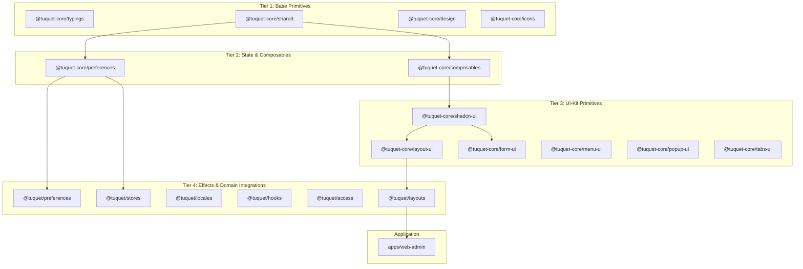

# Spec: Kiến Trúc Monorepo & Hạ Tầng Nền Tảng (`platform-foundation`)

> **Mã đặc tả:** `SPEC-platform-foundation`  
> **Module id:** `platform-foundation` (xem [`CAPABILITY-map-web-admin.md`](CAPABILITY-map-web-admin.md))  
> **Kiến trúc nguồn:** [`docs/architecture/overview.md`](../architecture/overview.md)  
> **Trạng thái:** **ĐÃ HOÀN THÀNH (ACCEPTED & IMPLEMENTED)**

---

## 1. Objective (Mục Tiêu & Phạm Vi)

Module `platform-foundation` thiết lập và chuẩn hóa toàn bộ nền tảng kỹ thuật cho ứng dụng Admin (`apps/web-admin` / Web Admin), bao gồm cấu trúc phân tầng monorepo 39 packages, hạ tầng build cục bộ không phát sinh rủi ro tài nguyên CI (`build:local`), cơ chế kiểm soát vòng đời PWA (Service Worker anti-cache & auto-update), và thực thi cổng kiểm định chất lượng 4 bước trước khi chuyển giao mã nguồn.

### Trong phạm vi:

1. **Kiến Trúc Monorepo & Phân Tầng Package:**
   - Chuẩn hóa ranh giới 39 packages theo cấu trúc 4 tầng: Base Primitives (`@tuquet-core/*`), State & Composables, UI-Kit Primitives, và Effects/Domain Integrations (`@tuquet/*`).
   - Quản lý phiên bản tập trung qua `pnpm-workspace.yaml` bằng catalog (`catalog:`), loại bỏ hardcode version số lẻ tại package con.
2. **Hạ Tầng Build Cục Bộ (`build:local`):**
   - Tự động hóa kiểm tra tài nguyên đĩa cứng ($\le 85\%$), dọn cache `.turbo` khi cần thiết.
   - Giới hạn bộ nhớ Node heap `--max-old-space-size=4096` tránh lỗi OOM khi biên dịch DTS.
   - Ghi nhận telemetry bản build vào `apps/web-admin/dist/.build-meta.json`.
   - Nạp lại Nginx graceful reload và phục vụ qua cổng loopback cục bộ (`http://127.0.0.1/`) với Zero WAN Port Exposure.
3. **Quản Lý Vòng Đời PWA & Header Chống Cache:**
   - Cấu hình Vite PWA với `registerType: 'autoUpdate'`, `workbox.skipWaiting: true`, và `workbox.clientsClaim: true`.
   - Nginx phục vụ `sw.js`, `manifest.webmanifest`, và `_app-config-*.js` với `Cache-Control: no-cache, no-store, must-revalidate; Expires: 0`.
4. **Cổng Kiểm Định Chất Lượng Pre-Push 4 Bước:**
   - Bước 1 (Typecheck): `pnpm run check:type` (`turbo run typecheck`) đạt 0 lỗi trên 39 packages.
   - Bước 2 (Lint & Format): `pnpm run lint` (`oxlint` + `oxfmt` + `eslint` + `stylelint`) đạt 0 lỗi.
   - Bước 3 (Headless Runtime Check): `pnpm run check:console` xác minh toàn bộ routes với 0 cảnh báo/lỗi runtime.
   - Bước 4 (Admin Build): `pnpm run build:admin` đóng gói thành công.

---

## 2. Tech Stack

- **Monorepo & Workspace:** `pnpm@11.16.0` (Catalog protocol) + `turbo@2.10.13`.
- **Frontend Core:** Vue 3.5 (`<script setup lang="ts">`), Vite 8, TypeScript 5, Pinia, Vue Router 4.
- **Design System & Table Engine:** Tailwind CSS v4 (`internal/tailwind-config/src/theme.css`), `@tuquet/vue-ui`, `@tuquet/vue-table` (`useVbenVxeGrid` / `VxeTable`, `VxeForm`), `@lucide/vue`.
- **Quality & Tooling:** Vitest (`happy-dom`), `vue-tsc`, `oxlint`, `oxfmt`, `eslint`, `stylelint`, `vite-plugin-pwa`.

---

## 3. Commands (Lệnh Thực Thi & Kiểm Định)

```bash
# 1. Kiểm tra kiểu dữ liệu TypeScript toàn bộ 39 packages
pnpm run check:type

# 2. Kiểm tra linter và chuẩn hóa định dạng mã nguồn
pnpm run lint
pnpm run format

# 3. Chạy toàn bộ bộ kiểm thử đơn vị (Vitest)
pnpm run test:unit

# 4. Đóng gói ứng dụng web-admin production
pnpm run build:admin

# 5. Thực thi bản dựng kiểm chứng cục bộ qua Nginx (Zero Git Push)
pnpm run build:local
```

---

## 4. Project Structure (Cấu Trúc Tệp Tác Động)

```text
admin/
├── pnpm-workspace.yaml                       # Khai báo workspace & catalog tập trung
├── turbo.json                                # Điều phối pipeline build, typecheck, test
├── package.json                              # Các scripts cấp root (check:type, lint, build:local)
├── scripts/
│   ├── build-local.sh                        # Kịch bản 5 bước build & nạp Nginx an toàn
│   └── check-console.mjs                     # Kịch bản kiểm định console runtime bằng trình duyệt headless
├── internal/
│   ├── lint-configs/                         # Cấu hình oxlint, oxfmt, eslint, stylelint, commitlint
│   ├── tailwind-config/src/theme.css         # SSOT CSS Variables Design Tokens (HSL)
│   ├── tsconfig/                             # Cấu hình TypeScript cơ sở
│   └── vite-config/                          # Plugins Vite (PWA, compress, app-loading)
├── packages/
│   ├── @core/                                # Tầng 1-3: base, composables, preferences, ui-kit
│   └── effects/                              # Tầng 4: access, layouts, locales, plugins, request
└── apps/
    └── web-admin/                            # Ứng dụng quản trị chính (@tuquet/admin-web)
```

---

## 5. Code Style & Kiến Trúc Chi Tiết

### 5.1. Kiến Trúc Phân Tầng Monorepo (Package Topology)

Hệ thống monorepo gồm 39 packages được phân cấp theo 4 tầng phụ thuộc đơn hướng (không có vòng lặp):



- **Zero Domain Clutter in Core:** Toàn bộ business logic và các views nghiệp vụ chỉ tồn tại trong `apps/web-admin/src/views/`, không đưa vào `packages/`.
- **Defu Array Duplication Defense:** Sử dụng `mergeWithArrayOverride` từ `@tuquet-core/shared` thay cho hàm merge gốc của `defu` nhằm tránh hiện tượng nhân đôi mảng cấu hình.
- **Strict Order-Sensitive Diffing:** Cung cấp hàm `diffStrict` so sánh thứ tự mảng (`arraysStrictEqual`) để phát hiện chính xác việc sắp xếp lại các widget trên Header.

### 5.2. Cấu Hình Nginx & Header Chống Cache Cho PWA

```nginx
# Service Worker và Webmanifest: Bắt buộc không lưu cache
location ~* (?:sw\.js|workbox-[^/]+\.js|manifest\.webmanifest|_app-config.*\.js)$ {
    expires -1;
    add_header Cache-Control "no-cache, no-store, must-revalidate";
    add_header Pragma "no-cache";
    add_header Expires "0";
    access_log off;
}

# Production hashed assets: Lưu cache 30 ngày
location ~* \.(?:css|js|woff2?|svg|png|jpg|jpeg|gif|ico|webp)$ {
    expires 30d;
    add_header Cache-Control "public, max-age=2592000, immutable";
    access_log off;
}
```

### 5.3. Universal Data Access & VxeGrid Pattern

```typescript
import { supabaseRequest } from '#/api/core/supabase-client';

export async function getFleetDevicesApi(status?: string) {
  const query = new URLSearchParams({
    select:
      'id,machine_id,name,status,tags,cpu_usage,memory_usage,last_heartbeat_at',
    order: 'last_heartbeat_at.desc',
  });
  if (status) query.append('status', `eq.${status}`);

  return supabaseRequest<FleetDevice[]>({
    path: `/rest/v1/devices?${query.toString()}`,
    options: {
      method: 'GET',
      schema: 'workers', // Tự động đính kèm Accept-Profile: workers
    },
  });
}
```

---

## 6. Testing Strategy (Chiến Lược Kiểm Thử)

| Tầng Kiểm Thử | Công Cụ & Lệnh | Tiêu Chuẩn Nghiệm Thu |
| :-- | :-- | :-- |
| **Unit Tests** | `pnpm run test:unit` (`vitest run`) | 100% tests pass trên router, api, preferences, components. |
| **Type Integrity** | `pnpm run check:type` | `vue-tsc` kết thúc với **0 lỗi** trên 39 packages. |
| **Code Formatting** | `oxfmt --check` | Toàn bộ tệp mã nguồn tuân thủ cấu hình chuẩn. |
| **Linting** | `pnpm run lint` (`oxlint` + `eslint` + `stylelint`) | **0 warnings, 0 errors**. |
| **Local Verification** | `pnpm run build:local` | Nginx phản hồi HTTP 200 trên `http://127.0.0.1/`. |

---

## 7. Boundaries (Ranh Giới Kỹ Thuật)

- **Always:**
  - Thực thi `pnpm run build:local` để kiểm chứng trước khi kết thúc phiên làm việc.
  - Dùng `catalog:` trong `pnpm-workspace.yaml` khi khai báo dependency dùng chung.
  - Dùng đường dẫn tương đối trong toàn bộ tài liệu markdown (`*.md`).
  - Phục vụ `sw.js` và manifest với header `no-cache, no-store`.
- **Ask first:**
  - Cập nhật phiên bản Node.js hoặc pnpm corepack.
  - Thay đổi cấu trúc schema của Nginx hoặc các port lắng nghe.
  - Thêm package bên ngoài vào danh mục `catalog`.
- **Never:**
  - Tuyệt đối không chạy `git push` hoặc kích hoạt remote GitHub Actions CI khi người dùng không yêu cầu.
  - Tuyệt đối không import `@supabase/supabase-js` trong mã nguồn client.
  - Tuyệt đối không sử dụng mock data hoặc chuỗi văn bản không liên quan.
  - Tuyệt đối không hardcode mã màu tĩnh (`bg-[#0f172a]`) thay cho semantic CSS variables.

---

## 8. Success Criteria (Tiêu Chí Nghiệm Thu)

- [x] **SC1:** Script `scripts/build-local.sh` hoạt động ổn định, kiểm tra dung lượng đĩa và nạp bản build thành công vào Nginx.
- [x] **SC2:** Lệnh `pnpm run build:local` được cấu hình trong `package.json` và thực thi mượt mà.
- [x] **SC3:** Tệp `apps/web-admin/vite.config.ts` tích hợp đầy đủ `registerType: 'autoUpdate'`, `workbox.skipWaiting: true` và `workbox.clientsClaim: true`.
- [x] **SC4:** Header phản hồi của `http://127.0.0.1/sw.js` chứa đầy đủ `Cache-Control: no-cache, no-store, must-revalidate; Expires: 0`.
- [x] **SC5:** Toàn bộ unit tests, `pnpm run check:type`, và `pnpm run lint` đạt 100% pass với 0 lỗi.

---

## 9. Resolved Decisions (Các Quyết Định Đã Chốt)

1. **Quản lý phiên bản tập trung qua PNPM Catalog:** Toàn bộ 39 packages trong workspace tham chiếu phiên bản thư viện qua `"catalog:"` trong `pnpm-workspace.yaml`, triệt tiêu xung đột phiên bản lệch giữa các gói `@tuquet-core/*` và `apps/web-admin`.
2. **Cơ chế tự động cập nhật PWA tức thì (`autoUpdate` + `no-cache`):** Kết hợp `skipWaiting: true` trong Workbox và header `Cache-Control: no-cache, no-store` trên Nginx cho `sw.js` / `_app-config-*.js` để trình duyệt luôn nhận bản build mới ngay khi tải lại trang.
