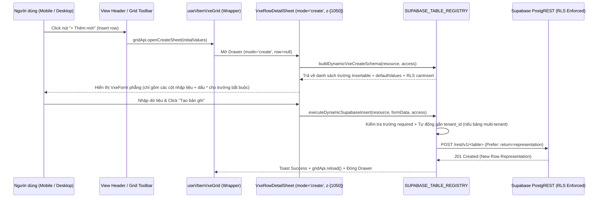

# Đặc Tả Kỹ Thuật: Kiến Trúc Động Supabase Studio CRUD (`Insert` / `Inspect` / `Patch`) Kết Hợp `VxeGrid`, `VxeForm` & Stacked Relational Drawer (`mobile-vxe-detail-sheet`)

> **Module ID:** `mobile-vxe-detail-sheet` | **Phiên bản:** `2.2.0 (Supabase Studio Insert Row & Unified SSOT CRUD Drawer)` | **Trạng thái:** `ACCEPTED & IMPLEMENTED (v2.2.0 — Comprehensive SSOT CRUD Refactor)`  
> **Bản đồ năng lực:** [`CAPABILITY-map-web-admin.md`](CAPABILITY-map-web-admin.md) | **Kiến trúc tổng thể:** [`docs/architecture/overview.md`](../architecture/overview.md)

---

## 0. Giả Định & Quyết Định Kiến Trúc Enterprise (Assumptions & Architectural Pillars)

### 0.1. Các giả định thiết kế (`ASSUMPTIONS`)

1. **Chuẩn hành vi Supabase Studio "Insert row" & Hợp nhất SSOT (Xóa bỏ Modal CRUD trùng lặp):**
   - Trong Supabase Dashboard (Table Editor), khi người dùng bấm nút **`+ Thêm mới` (`Insert row`)**, hệ thống **không** mở các `<Dialog>` rời rạc giữa màn hình mà trượt mở **chính chiếc Drawer bên phải (`VxeRowDetailSheet` ở chế độ `mode = 'create'`)** trên Desktop (`side="right"`, `z-[1050]`) và Bottom Sheet trên Mobile (`side="bottom"`, `z-[1050]`).
   - Để đảm bảo tính duy trì mã nguồn **Single Source of Truth (SSOT)**:
     - Xóa bỏ `CreateWorkspaceModal` (`src/views/tenants/components/modals/create-workspace-modal.vue`) tại `tenants/index.vue`, hợp nhất vào `gridApi.openCreateSheet()` với `detailSheetOptions.onCreate` gọi `createTenantApi`.
     - Xóa bỏ `Edit Payment Gateway Modal` (`gatewayModalOpen`) và cột nút `Cấu hình` dư thừa tại `commerce/admin/index.vue`, hợp nhất cả Tạo mới và Chỉnh sửa `billing.payment_gateways` vào `gatewaysGridApi.openCreateSheet()` / click dòng mở `VxeRowDetailSheet`.
     - Chỉ giữ lại duy nhất các Modal nghiệp vụ phi-CRUD đơn bảng (`ConnectFleetModal` ghép nối CLI daemon tại `automation/devices/index.vue`, và Modal tạo đồng thời `Product + SKU Variant` / `Bulk Stock Import` tại `commerce/admin/index.vue`).
2. **Ẩn trường hệ thống tự sinh & Chỉ hiển thị trường nhập liệu hợp lệ khi Tạo mới (`Create Mode`):**
   - Khác với chế độ Xem/Sửa (`mode = 'edit'`) vốn hiển thị cả các cột chỉ đọc (`created_at`, `updated_at`, `member_count`, `tenant_name`...), ở chế độ **Tạo mới (`mode = 'create'`)**:
     - Các cột tự sinh bởi Postgres (`id` kiểu `uuid` tự sinh qua `gen_random_uuid()`, `created_at`, `updated_at`, `installed_at`, `last_seen_at`) và các cột ảo/join chỉ đọc (`member_count`, `tenant_count`, `permission_count`, `sold_count`, `nodeCount`, `triggerSummary`) được **ẩn tự động** khỏi form tạo mới để giao diện gọn sạch đúng chuẩn Supabase Studio.
     - Các cột khóa chính do người dùng định nghĩa mã (`id` kiểu `text` có `insertable: true` như `public.permissions.id` = `automation:jobs:run`, `billing.plans.id` = `enterprise`, `public.system_plugins.id` = `webhooks`, `billing.payment_gateways.id` = `sepay_vietqr`) sẽ **hiển thị ở đầu form khi tạo mới (`mode = 'create'`)** nhưng tự động khóa chỉ đọc khi chuyển sang sửa (`mode = 'edit'`).
3. **Tự động gắn ngữ cảnh Workspace (`tenant_id`) & Giá trị mặc định (`defaultValue`) + Tự sinh `slug`:**
   - Với các bảng đa thuê bao (multi-tenant) như `automation.workflows`, `workers.browsers`, `workers.proxies`, khi thực thi `executeDynamicSupabaseInsert`, hệ thống tự động đính kèm `tenant_id = getActiveTenantId()` nếu bảng có cột `tenant_id` mà form chưa truyền.
   - Với các bảng có cả `name` và `slug` (`public.tenants`, `commerce.products`), khi ở chế độ `mode = 'create'`, gõ `name` sẽ tự động gợi ý `slug` chuẩn kebab-case nếu người dùng chưa tự sửa ô `slug`.
4. **Phân quyền RLS `canInsert` & Đồng bộ nút `+ Thêm mới` trên toàn bộ các màn hình CRUD:**
   - Mở rộng `SUPABASE_TABLE_REGISTRY` với quyết định RLS `canInsert` và thuộc tính cột `insertable?: boolean`, `defaultValue?: any`, `placeholderKey?: string`.
   - Không bật tạo bản ghi thủ công cho các bảng sổ cái bất biến (`public.audit_logs`, `billing.wallet_transactions`), bảng đồng bộ từ Auth/Checkout (`public.profiles`, `commerce.orders`, `billing.payment_intents`, `automation.jobs`), hoặc bảng có luồng ghép nối daemon chuyên biệt (`workers.devices` dùng `ConnectFleetModal`).
   - Đồng bộ nút **`+ Thêm mới` (`common.createRecord`)** kích hoạt `gridApi.openCreateSheet()` trên toàn bộ 9 màn hình/tab quản trị:
     - `tenants/index.vue` (`public.tenants` — thay thế hoàn toàn `CreateWorkspaceModal`)
     - `automation/workflows/index.vue` (`automation.workflows`)
     - `automation/browsers/index.vue` (`workers.browsers`)
     - `automation/proxies/index.vue` (`workers.proxies`)
     - `system/roles/index.vue` (Tab `public.roles` & Tab `public.permissions`)
     - `system/plugins/index.vue` (`public.system_plugins`)
     - `system/plans/index.vue` (`billing.plans`)
     - `system/subscriptions/index.vue` (`billing.subscriptions`)
     - `commerce/admin/index.vue` (Tab `billing.payment_gateways` — thay thế hoàn toàn `gatewayModalOpen`)
4. **Triết Lý Chiều Cao Linh Hoạt & Siêu Tinh Gọn (Antigravity Micro Grabber & Height Presets):**
   - Khi hiển thị Bottom Sheet trên Mobile / Tablet (`side="bottom"`), tránh lãng phí diện tích màn hình:
     - **Zero-Padding Micro Grabber:** Đặt một dải chỉ báo mỏng `h-1 w-10 rounded-full bg-muted-foreground/25` sát mép viền trên cùng (`pt-1.5 pb-0.5`), tuyệt đối không tạo một hàng trống lớn gây tốn diện tích thông tin.
     - **Chuyển đổi Chiều Cao 1-Click (Compact vs Full Height Toggle):** Cung cấp nút chuyển đổi kích thước nhanh (Maximize / Minimize icon) tích hợp trực tiếp vào thanh tiêu đề (Header):
       - `Compact Mode (52vh)`: Tối ưu cho việc xem nhanh hoặc chỉnh sửa các form ít trường (như Proxy, Status).
       - `Full Mode (92vh)`: Bung rộng tối đa để nhập form dài (như Workspace Settings, Fingerprint, JSON parameters).
     - **Header Spacing Siêu Tinh Gọn:** Giảm padding dọc xuống `px-4 py-2.5 sm:px-5 sm:py-3` để đưa thông tin nội dung lên cao nhất, đạt mật độ hiển thị tối đa chuẩn Enterprise.

---

## 1. Mục Tiêu & Phạm Vi (Objective & Scope)

- **Mục tiêu:**
  1. **Inspect & Quick Edit (`mode = 'edit'`, đã hoàn thành ở v2.1.0):** Click vào dòng trên bảng mở `VxeRowDetailSheet` nổi trên `LayoutHeader` (`z-[1050]`), ẩn `schema.table` & `RLS Policy` vào Popover chỉ dành cho Superadmin, hiển thị một `VxeForm` phẳng duy nhất + mở Stacked Relational Drawer (`VxeRelationalTableSheet` ở `z-[1070]`) cho các bảng quan hệ.
  2. **Create / Insert Row (`mode = 'create'`, bổ sung ở v2.2.0):**
     - Cung cấp phương thức `gridApi.openCreateSheet(initialValues?: Partial<T>)` trên mọi instance của `useVbenVxeGrid`.
     - Khi mở ở chế độ `mode = 'create'`, `VxeRowDetailSheet` tự động dựng form nhập liệu phẳng từ `buildDynamicVxeCreateSchema`: khởi tạo sẵn `defaultValue`, đánh dấu trường bắt buộc (`required: true` kèm dấu `*`), kiểm tra validation trước khi gửi `POST /rest/v1/<table>` (`Prefer: return=representation`), cập nhật lại `VxeGrid` (`gridApi.reload()`) và hiển thị thông báo thành công.
     - Trang bị nút **`+ Thêm mới`** đồng bộ trên thanh Header của các màn hình quản trị có `canInsert.allowed === true`.

---

## 2. Ngăn Xếp Công Nghệ & Lệnh Thực Thi (Tech Stack & Commands)

### 2.1. Ngăn xếp công nghệ

- **Frontend Core:** Vue 3.5+, TypeScript 5.8+, Tailwind CSS v4.
- **UI & VXE Engine:**
  - `@tuquet/vue-ui`: `Sheet`, `SheetContent`, `SheetHeader`, `SheetTitle`, `SheetDescription`, `SheetFooter`, `Popover`, `PopoverTrigger`, `PopoverContent`, `Badge`, `Button`, `Input`, `Switch`, `Textarea`.
  - `#/adapter/vxe-table` (`vxe-table` + `vxe-pc-ui`): `useVbenVxeGrid`, `VxeForm`, `VxeFormItem`.
- **Data & Security Layer:**
  - `supabaseRequest({ method: 'POST' | 'PATCH', schema, preferRepresentation: true })` (`src/api/core/supabase-client.ts`).
  - `getEffectiveAccessApi()` (`src/api/core/access.ts`) & `getActiveTenantId()` (`src/api/core/supabase-client.ts`).

### 2.2. Lệnh kiểm tra & vận hành

```bash
# Kiểm tra khóa đa ngôn ngữ đối xứng en-US & vi-VN
pnpm --filter @tuquet/admin-web run check:i18n

# Chạy bộ kiểm thử đơn vị (Vitest)
pnpm --filter @tuquet/admin-web exec vitest run src/api/core/__tests__/supabase-schema-registry.test.ts src/components/vxe-detail-sheet/__tests__/vxe-row-detail-sheet.test.ts

# Kiểm tra kiểu tĩnh TypeScript
pnpm --filter @tuquet/admin-web run typecheck
```

---

## 3. Kiến Trúc Tệp & Ma Trận CRUD Supabase (Project Structure & CRUD Matrix)

### 3.1. Cấu trúc tệp

```text
admin/apps/web-admin/src/
├── adapter/
│   └── vxe-table.ts                                    # [CẬP NHẬT] Bổ sung gridApi.openCreateSheet(initialValues) & truyền mode ('create' | 'edit') xuống VxeRowDetailSheet
├── api/core/
│   ├── supabase-schema-registry.ts                     # [CẬP NHẬT] Bổ sung canInsert RLS, defaultValue/insertable, buildDynamicVxeCreateSchema, computeInsertPayload & executeDynamicSupabaseInsert (POST)
│   └── __tests__/
│       └── supabase-schema-registry.test.ts            # [CẬP NHẬT] Unit tests cho buildDynamicVxeCreateSchema, computeInsertPayload & executeDynamicSupabaseInsert
├── components/vxe-detail-sheet/
│   ├── types.ts                                        # [CẬP NHẬT] Bổ sung kiểu VxeDetailSheetMode ('create' | 'edit') và hook onCreate / onCreated
│   ├── vxe-row-detail-sheet.vue                        # [CẬP NHẬT] Hỗ trợ song song Create Mode (Insert Row) & Edit Mode (Inspect/Patch Row), auto-slug, required validation
│   └── __tests__/
│       └── vxe-row-detail-sheet.test.ts                # [CẬP NHẬT] Unit tests kiểm thử Create Mode Drawer, validation trường bắt buộc và thực thi POST
├── views/
│   ├── automation/
│   │   ├── workflows/index.vue                         # [CẬP NHẬT] Thêm nút "+ Thêm mới" trên Header gọi gridApi.openCreateSheet()
│   │   ├── browsers/index.vue                          # [CẬP NHẬT] Thêm nút "+ Thêm mới" trên Header gọi gridApi.openCreateSheet()
│   │   └── proxies/index.vue                           # [CẬP NHẬT] Thêm nút "+ Thêm mới" trên Header gọi gridApi.openCreateSheet()
│   └── system/
│       ├── roles/index.vue                             # [CẬP NHẬT] Thêm nút "+ Thêm mới" trên Header mở Create Sheet theo tab đang chọn (Roles / Permissions)
│       ├── plugins/index.vue                           # [CẬP NHẬT] Thêm nút "+ Thêm mới" trên Header gọi gridApi.openCreateSheet()
│       ├── plans/index.vue                             # [CẬP NHẬT] Thêm nút "+ Thêm mới" trên Header gọi gridApi.openCreateSheet()
│       └── subscriptions/index.vue                     # [CẬP NHẬT] Thêm nút "+ Thêm mới" trên Header gọi gridApi.openCreateSheet()
```

### 3.2. Ma Trận Hành Vi `INSERT` (Tạo Bản Ghi Mới) Trên 18 Bảng Supabase

| # | Supabase Resource (`schema.table`) | Tệp View (`src/views/...`) | Cho phép Tạo mới (`canInsert`) | Các cột hiển thị trong Drawer Tạo Mới (`mode = 'create'`) | Giá trị khởi tạo mặc định (`defaultValue`) |
| :-: | :-- | :-- | :-- | :-- | :-- |
| 1 | `public.tenants` | `tenants/index.vue` | Có (`Authenticated user`) | `name*`, `slug*` (auto từ `name`), `plan`, `status` | `plan: 'pro'`, `status: 'active'` |
| 2 | `automation.workflows` | `automation/workflows/index.vue` | Có (`Superadmin` hoặc `automation.workflows.manage`) | `name*`, `description`, `version`, `status` (+ tự gắn `tenant_id`) | `version: '1.0.0'`, `status: 'draft'` |
| 3 | `workers.browsers` | `automation/browsers/index.vue` | Có (`Superadmin` hoặc `workers.manage`) | `name*`, `os_platform`, `browser_version`, `status`, `proxy_id` (+ tự gắn `tenant_id`) | `os_platform: 'windows'`, `browser_version: '134.0'`, `status: 'idle'` |
| 4 | `workers.proxies` | `automation/proxies/index.vue` | Có (`Superadmin` hoặc `workers.manage`) | `host*`, `port*`, `protocol`, `country_code`, `is_residential`, `status` (+ tự gắn `tenant_id`) | `port: 1080`, `protocol: 'socks5'`, `country_code: 'VN'`, `is_residential: false`, `status: 'active'` |
| 5 | `public.roles` | `system/roles/index.vue` (Tab Roles) | Có (`Superadmin` hoặc `roles.manage`) | `name*`, `description` (+ tự gắn `is_system: false`) | `is_system: false` |
| 6 | `public.permissions` | `system/roles/index.vue` (Tab Permissions) | Có (`Platform Superadmin`) | `id*` (chỉ nhập khi tạo mới, VD: `automation:jobs:run`), `module*`, `description` | `module: 'core-iam'` |
| 7 | `public.system_plugins` | `system/plugins/index.vue` | Có (`Platform Superadmin`) | `id*` (chỉ nhập khi tạo mới), `name*`, `version`, `description`, `status`, `metadata` | `version: '1.0.0'`, `status: 'installed'`, `metadata: {}` |
| 8 | `billing.plans` | `system/plans/index.vue` | Có (`Platform Superadmin`) | `id*` (chỉ nhập khi tạo mới), `name*`, `description`, `price_monthly_usd`, `max_members`, `max_storage_mb`, `max_monthly_runs`, `is_active`, `metadata` | `price_monthly_usd: 29`, `max_members: 10`, `max_storage_mb: 10240`, `max_monthly_runs: 5000`, `is_active: true`, `metadata: {}` |
| 9 | `billing.subscriptions` | `system/subscriptions/index.vue` | Có (`Platform Superadmin`) | `tenant_id*`, `plan_id*`, `status`, `cancel_at_period_end` | `plan_id: 'pro'`, `status: 'active'`, `cancel_at_period_end: false` |
| 10 | `commerce.products` | `commerce/admin/index.vue` | Có (`Platform Superadmin`) | `name*`, `slug*` (auto từ `name`), `product_type`, `visibility`, `is_active`, `short_description`, `sort_order` | `product_type: 'serial_stock'`, `visibility: 'public'`, `is_active: true`, `sort_order: 0` |
| 11 | `billing.payment_gateways` | `commerce/admin/index.vue` | Có (`Platform Superadmin`) | `provider_code*` (chỉ nhập khi tạo mới), `display_name*`, `rate_per_credit`, `is_active`, `sort_order`, `public_config` | `rate_per_credit: 1000`, `is_active: true`, `sort_order: 0`, `public_config: {}` |
| 12–18 | `public.audit_logs`, `billing.wallet_transactions`, `billing.payment_intents`, `commerce.orders`, `public.profiles`, `automation.jobs`, `workers.devices` | Các màn hình tương ứng | **Không** (`canInsert.allowed = false` trên generic Drawer) | _(Sổ cái bất biến / Dữ liệu phát sinh từ giao dịch hoặc luồng kết nối CLI chuyên biệt)_ | — |

---

## 4. Quy Chuẩn Code & Luồng Hoạt Động (Code Style & Data Flow)

### 4.1. Luồng hoạt động `Insert Row` chuẩn Supabase Studio



### 4.2. Mẫu cấu trúc cột hỗ trợ đồng thời `Insert` và `Update` trong `SUPABASE_TABLE_REGISTRY`

```typescript
export interface SupabaseColumnSchema {
  defaultValue?: (() => any) | any;
  editable?: boolean;
  enumMeta?: Record<string, EnumItemMeta>;
  field: string;
  /** Cho phép nhập cột này khi Tạo mới (VD: khóa chính kiểu text `id` của plans/permissions/plugins), mặc định kế thừa từ `editable` */
  insertable?: boolean;
  isFieldLocked?: (row: Record<string, any>) => boolean;
  labelKey?: string;
  max?: number;
  min?: number;
  options?: Array<{ label: string; value: number | string }>;
  placeholderKey?: string;
  required?: boolean;
  type: DynamicFieldType;
}
```

---

## 5. Chiến Lược Kiểm Thử & Ranh Giới (Testing & Boundaries)

### 5.1. Kiểm thử đơn vị (Vitest)

- `src/api/core/__tests__/supabase-schema-registry.test.ts`:
  - Kiểm thử `buildDynamicVxeCreateSchema` chỉ lấy các cột `insertable || editable`, loại bỏ các cột chỉ đọc/tự sinh (`created_at`, `updated_at`, `member_count`, `id` kiểu `uuid`), nhưng giữ lại `id` kiểu `text` có `insertable: true` (như `public.permissions`, `billing.plans`, `public.system_plugins`).
  - Kiểm thử `computeInsertPayload` và `executeDynamicSupabaseInsert`: tự động điền `defaultValue`, kiểm tra các cột `required: true`, tự động gắn `tenant_id` cho các bảng thuộc schema `automation` / `workers`, và gọi `POST /rest/v1/<table>`.
- `src/components/vxe-detail-sheet/__tests__/vxe-row-detail-sheet.test.ts`:
  - Kiểm thử `VxeRowDetailSheet` khi mở với `mode="create"`: hiển thị nút tạo mới (`data-testid="vxe-detail-sheet-create"`), khởi tạo sẵn giá trị mặc định, tự động sinh `slug` từ `name` (khi tạo `public.tenants` hoặc `commerce.products`), chặn submit nếu thiếu trường `required`, và phát sự kiện `created` sau khi lưu thành công.

### 5.2. Ranh giới (Boundaries)

- **Luôn thực hiện (Always):**
  - Tuân thủ nghiêm ngặt `Sentence case`, thang chữ 7 bậc (`text-2xs` đến `text-2xl` theo `skills/rules/TYPOGRAPHY.md`), và đối xứng 100% khóa đa ngôn ngữ `en-US` / `vi-VN` (`pnpm run check:i18n`).
  - Ẩn hoàn toàn tên bảng vật lý (`schema.table`) và tên `RLS Policy` khỏi giao diện người dùng thường; chỉ hiển thị trong Popover của Superadmin.
- **Hỏi trước khi làm (Ask first):**
  - Thay đổi cấu trúc bảng SQL hoặc thêm thư viện bên thứ ba mới.
- **Không thực hiện (Never):**
  - Không cho phép mở form tạo mới đối với các bảng sổ cái bất biến (`public.audit_logs`, `billing.wallet_transactions`).
  - Không chứa đường dẫn tuyệt đối của máy trạm trong mã nguồn hoặc tài liệu.

---

## 6. Tiêu Chí Nghiệm Thu (Success Criteria)

- [x] `SUPABASE_TABLE_REGISTRY` hỗ trợ đầy đủ `canInsert`, `buildDynamicVxeCreateSchema`, `computeInsertPayload`, và `executeDynamicSupabaseInsert` (`POST /rest/v1/<table>`).
- [x] `useVbenVxeGrid` cung cấp API `gridApi.openCreateSheet(initialValues?)` mở `VxeRowDetailSheet` ở chế độ `mode = 'create'`.
- [x] Trong chế độ `mode = 'create'`, `VxeRowDetailSheet` chỉ hiển thị các trường cho phép nhập mới (ẩn các trường chỉ đọc/tự sinh), điền sẵn giá trị mặc định hợp lý, đánh dấu `*` cho trường bắt buộc, tự động gợi ý `slug` khi nhập `name`, và hỗ trợ hook `onCreate` / `onCreated`.
- [x] Refactor toàn diện theo chuẩn SSOT:
  - `tenants/index.vue` chuyển nút tạo mới sang `gridApi.openCreateSheet()` (kèm `onCreate` gọi `createTenantApi`) và xóa bỏ hoàn toàn file `create-workspace-modal.vue`.
  - `commerce/admin/index.vue` (Tab `gateways`) chuyển tạo mới/chỉnh sửa sang `gatewaysGridApi.openCreateSheet()` + click dòng mở `VxeRowDetailSheet`, xóa bỏ hoàn toàn `gatewayModalOpen` và cột nút `Cấu hình` dư thừa.
  - Toàn bộ 7 màn hình quản trị đang thiếu chức năng tạo bản ghi (`workflows`, `browsers`, `proxies`, `roles & permissions`, `plugins`, `plans`, `subscriptions`) có nút **`+ Thêm mới`** trên Header mở Drawer Tạo Mới chuẩn Supabase Studio.
- [x] Pass 100% `check:i18n`, `vitest run`, và `typecheck`.

---

## 7. Quyết Định Đã Phê Duyệt (Resolved Architectural Decisions)

1. **Refactor toàn diện theo chuẩn SSOT (Single Source of Truth):**
   - Hợp nhất toàn bộ luồng tạo mới (`Insert Row`) và chỉnh sửa (`Inspect / Patch Row`) của các bảng dữ liệu đơn về một kiến trúc duy nhất: `SUPABASE_TABLE_REGISTRY` + `VxeRowDetailSheet` (`mode = 'create' | 'edit'`) + `gridApi.openCreateSheet()`.
   - Xóa bỏ các Modal CRUD đơn bảng rời rạc (`CreateWorkspaceModal` trong `tenants`, `gatewayModalOpen` trong `commerce/admin`).
   - Giữ nguyên duy nhất các Modal tác vụ đặc thù đa bước/ngoại vi (`ConnectFleetModal` ghép nối CLI daemon và Modal `Bulk Stock Import` / `Product + Variant Upsert`).
